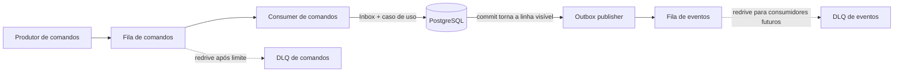

# Arquitetura — Sistema Distribuído de Controle de Dividendos

## Escopo desta etapa

Esta documentação descreve as Etapas 1 a 11 do sistema de dividendos. A Etapa 1 configurou workspace, NestJS, PostgreSQL/MikroORM, SQS/LocalStack, React/Vite e health checks. A Etapa 2 implementou domínio independente do ORM. A Etapa 3 preparou persistência transacional e testes destinados a PostgreSQL real, ainda pendentes de execução conjunta. A Etapa 4 implementou casos de uso e API HTTP; a Etapa 5, processamento distribuído de comandos/eventos. A Etapa 6 entrega o painel administrativo e suas leituras paginadas. A Etapa 10 prepara autenticação OIDC, autorização por papel/permissão e auditoria administrativa em log estruturado; um IdP não foi escolhido nem configurado. A Etapa 11 prepara testes com PostgreSQL nativo no Windows, mas o servidor não estava disponível na máquina verificada em 2026-11-16. Não há confirmação de liquidação nem pagamentos reais.

O README do desafio original foi preservado em [`docs/README-desafio-original.md`](docs/README-desafio-original.md) apenas como referência histórica. Requisitos de apostas e jogos não fazem parte do escopo atual.

## Decisões técnicas

- **Workspace:** Bun workspaces com pacotes `@dividend/backend` e `@dividend/frontend`.
- **Backend:** NestJS, TypeScript em modo estrito e Bun para execução, desenvolvimento e testes.
- **Persistência:** PostgreSQL com MikroORM. EntitySchemas ficam na infraestrutura; o domínio não recebe decorators do ORM. Repositórios usam SQL parametrizado para transações, locks e constraints de banco.
- **Mensageria:** AWS SDK for JavaScript v3 com endpoint configurável; LocalStack fornece SQS local.
- **Frontend:** React, TypeScript e Vite. O painel tem seis seções administrativas, usa uma camada HTTP comum e aceita somente base URL HTTP loopback.
- **Migrations:** `Migration20261116000000` cria o schema base e `Migration20261116010000` adiciona o estado terminal de Outbox `DEAD_LETTERED`; ambas são versionadas e têm rollback. Schema de negócio evolui somente por migrations; não usar `schema.update()` em execução.
- **Health:** `/health/live` responde sem consultar dependências; `/health/ready` verifica PostgreSQL e SQS e responde HTTP 503 quando uma dependência está indisponível.
- **Configuração local:** copiar `.env.example` para `.env`. Valores AWS no exemplo são credenciais fictícias para LocalStack, não credenciais bancárias.
- **API HTTP:** controllers traduzem requisições para casos de uso; serviços de aplicação dependem de portas de repositório, sem colocar regras de domínio nos controllers.
- **Workers:** um processo Nest separado executa o consumer de comandos e o publisher de Outbox, com endpoint Prometheus local próprio. O processo HTTP deixa `WORKERS_ENABLED=false` por padrão; `bun run dev:worker` habilita workers.
- **Limite local:** API, Vite e métricas de worker aceitam somente `localhost`, `127.0.0.1` ou `::1`. CORS permite a origem loopback exata configurada em `CORS_ORIGIN`; métodos GET/POST e cabeçalhos necessários, inclusive Authorization. O modo local de desenvolvimento desabilita auth explicitamente. O modo OIDC está preparado, sem provedor configurado.

## Topologia local

- `postgres`: persistência local em volume Docker e health check via `pg_isready`.
- `localstack`: serviço SQS local, estado persistido em volume e gateway na porta 4566.
- Portas host de PostgreSQL e LocalStack são vinculadas a `127.0.0.1`; API e frontend também rodam no host em loopback durante o desenvolvimento com Bun. O Dockerfile prepara uma imagem do backend.
- A imagem oficial `postgres:18-alpine` mudou o `PGDATA` e o mount recomendado para `/var/lib/postgresql/18/docker` e `/var/lib/postgresql`; o Compose atual ainda aponta `postgres-data` para `/var/lib/postgresql/data`. Essa divergência requer revisão antes de iniciar Compose. Não foi alterada nesta etapa porque nenhum volume Docker foi inspecionado; consultar a [documentação da imagem oficial PostgreSQL](https://github.com/docker-library/docs/blob/master/postgres/README.md) e preservar/migrar dados antes de trocar o caminho.

### Modo de desenvolvimento sem Docker

PostgreSQL nativo no Windows pode substituir somente o serviço `postgres`, por meio de `DATABASE_URL` e `TEST_DATABASE_URL`. API e frontend podem rodar no host; o backend mantém `WORKERS_ENABLED=false` por padrão. Sem LocalStack/SQS, a API pode servir rotas apoiadas no PostgreSQL, mas `/health/ready` reporta `503` porque sua definição também verifica SQS, e eventos Outbox não são publicados. O worker não deve ser iniciado sem SQS configurado. A suíte PostgreSQL usa uma URL de teste separada e agora recusa a execução se host/porta/banco coincidem com o alvo principal; essa comparação protege erros óbvios de configuração, não substitui revisão das URLs nem isolamento do servidor. O modo nativo não valida LocalStack, redrive, consumers distribuídos ou concorrência entre processos.

Na verificação da Etapa 11, `psql`, `pg_isready`, `postgres`, `initdb` e `createdb` não foram encontrados no `PATH`; também não foram encontrados serviço PostgreSQL, diretórios de instalação comuns ou servidor escutando em `127.0.0.1:5432`. Nenhuma tentativa de conexão ou migration foi feita. O workspace já separa `DATABASE_URL` (`dividend_control`) de `TEST_DATABASE_URL` (`dividend_control_test`); a suíte compara seus alvos antes de abrir conexão, mas a inspeção manual e um banco de teste dedicado continuam obrigatórios. Consulte as instruções Windows no README e o registro datado em `docs/VALIDATION_STATUS.md`.

## Domínio implementado na Etapa 2

- `Money` mantém um coeficiente `bigint` e uma escala decimal. Entradas e saídas são strings decimais sem expoente e operações não arredondam. A escala é preservada para serialização; códigos de moeda precisam estar em formato de três letras maiúsculas, mas ainda não há lista ISO nem escala por moeda.
- `DividendTerms` discrimina um valor declarado positivo ou parâmetros string opacos. Parâmetros não são interpretados e nenhum valor por beneficiário é calculado. A definição se o valor declarado é total, por unidade ou apenas informativo permanece pendente.
- `Dividend` transita apenas `DRAFT → DECLARED`. Termos e datas são imutáveis no domínio atual. Obrigações só podem ser emitidas depois da declaração.
- `Beneficiary` representa nesta etapa somente identidade interna; contato, dados fiscais e destino de pagamento foram deixados fora do modelo.
- A identidade de negócio de `DividendObligation` é `(dividendId, beneficiaryId)`. O agregado `Dividend` mantém uma verificação em memória para detectar uma segunda obrigação no mesmo agregado; isso é uma proteção local. A Etapa 3 também aplica `UNIQUE(dividend_id, beneficiary_id)` no PostgreSQL para a garantia distribuída.
- Estados da obrigação: `DUE → PAYMENT_REQUESTED → PAID`; também `PAYMENT_REQUESTED → PAYMENT_UNKNOWN → PAID`. `PAID` é terminal. Ainda não há retorno a `DUE`, cancelamento, reversão ou retry de pagamento.
- `Payment` é uma instrução lógica imutável com chave de idempotência fornecida pelo chamador. Nenhuma chamada bancária ou transferência é executada.
- `LedgerEntry` é um fato imutável com tipo, origem, valor positivo e obrigação. Sua identidade financeira usa `(sourceType, sourceId, kind)`. Não define partidas dobradas nem um plano de contas contábil. A migration da Etapa 3 aplica unicidade por origem e impede update/delete/truncate.
- Exceções de domínio carregam códigos estáveis em máquina, como `DUPLICATE_DIVIDEND_OBLIGATION`, `CURRENCY_MISMATCH` e `INVALID_OBLIGATION_STATE`.

## Persistência implementada na Etapa 3

- `dividends`, `beneficiaries`, `dividend_obligations`, `payments`, `ledger_entries`, `idempotency_records`, `inbox_messages` e `transactional_outbox` são mapeados por EntitySchema e criados pela migration versionada.
- `UNIQUE(dividend_id, beneficiary_id)` impede segunda obrigação para o par provisório aprovado; `payments.obligation_id UNIQUE` permite no máximo uma instrução lógica por obrigação. Os registros de idempotência usam `UNIQUE(scope, key)` e guardam SHA-256 do JSON canônico e referência ao resultado original.
- A criação de obrigação, reconhecimento no ledger e evento Outbox ocorre na mesma transação. A constraint trigger adiada exige o fato de reconhecimento correspondente antes do commit. A criação de pagamento mantém sob uma transação a reserva de idempotência, lock `FOR UPDATE` da obrigação, transição para `PAYMENT_REQUESTED`, instrução de pagamento e evento Outbox.
- A trava é por linha de obrigação; colisões de identidade da obrigação são resolvidas pela constraint única do banco. Inbox usa lock/unique key por consumidor e mensagem. Outbox reivindica lotes com `FOR UPDATE SKIP LOCKED`, lease token e expiração. Não há lock global.
- O banco impede alterações e exclusões de ledger e pagamentos lógicos, incluindo `TRUNCATE` para ambos. Triggers protegem os termos declarados, proíbem remover dividendos e protegem os valores/identidades das obrigações e suas transições permitidas.
- A view `obligation_ledger_reconciliation` compara montante e moeda do fato de reconhecimento com a obrigação. As migrations de rollback removem os objetos criados por esta versão.

## Processamento distribuído (Etapa 5)

O SQS continua at-least-once; as filas são **standard**, sem dependência de ordenação ou deduplicação FIFO. A criação e a configuração das filas ocorre via `SqsQueueManager`, incluindo `RedrivePolicy`, long polling e visibilidade configurável. Há quatro destinos distintos: `dividend-commands`, `dividend-commands-dlq`, `dividend-events` e `dividend-events-dlq` (nomes substituíveis por ambiente).

O consumer lê somente comandos: `dividend.create`, `dividend.declare`, `dividend-obligation.create` e `payment-instruction.request`. O envelope exige `messageId` estável, `type` permitido e `data`; `correlationId` usa `messageId` quando ausente. `SqsCommandPublisher` envia à fila de comandos e retornar um `brokerMessageId` significa apenas que o SQS aceitou a mensagem.

O consumer chama os mesmos casos de uso da API. `InboxRepository.processOnce` abre uma transação e fornece um contexto transacional opaco; os adapters dos repositórios reutilizam essa transação. Assim, o registro Inbox, o resultado do caso de uso, lançamentos e eventos Outbox commitam ou revertem juntos. O worker envia `DeleteMessage` apenas depois de `processOnce` retornar, ou seja, depois do commit. Falha no ack deixa a mensagem para nova entrega; a Inbox persistente reconhece a duplicata e permite ack posterior sem reaplicar efeitos.

Publisher reivindica lotes em transação com `FOR UPDATE SKIP LOCKED`, incrementa tentativas e grava token/lease. Envia eventos Outbox somente após a linha estar disponível fora do commit que originou o evento. Marca `PUBLISHED` somente depois de resposta bem-sucedida do SQS e exige o lease token para atualizar o registro. Se o processo cair depois do send e antes da marcação, a publicação pode ocorrer novamente; isso é at-least-once e cada consumidor de eventos precisará da própria Inbox. Eventos permitidos vão somente para a fila de eventos; o consumer deste sistema não lê essa fila, evitando ciclo.

Falhas transitórias no consumer aumentam `VisibilityTimeout` com backoff exponencial limitado. Formato inválido e falhas permanentes/de negócio não recebem ack e ficam visíveis imediatamente; a política de redrive da fila move a mensagem para DLQ depois de `SQS_MAX_RECEIVE_COUNT`. O publisher Outbox usa tentativas próprias e backoff; ao exceder `OUTBOX_MAX_ATTEMPTS`, mantém o payload na tabela Outbox em `DEAD_LETTERED` para inspeção operacional. Essa fila morta persistente do Outbox é separada das DLQs SQS.

`BeforeApplicationShutdown` para novas leituras e aguarda a recepção atual e as mensagens já recebidas terminarem; handlers concluídos são ackados, enquanto falhas permanecem não ackadas para redelivery. Logs de workers são JSON com correlationId e metadados da mensagem. `GET /metrics` expõe contadores locais por processo e duração acumulada (porta API 3000 quando co-hospedado; porta worker 3001 no modo separado); não é armazenamento durável nem mecanismo de coordenação.

O SQS é transporte de comandos/eventos, não confirmação de pagamento. Nenhum worker chama banco, muda obrigação para `PAID`, confirma liquidação ou trata mensagem enviada como prova de processamento. A publicação Outbox não altera o estado financeiro.

## Garantias para etapas futuras

Chamadas a provedores de pagamento ficarão fora de transações SQL. Para evitar pagamentos externos repetidos, o provedor escolhido precisa aceitar uma chave idempotente estável ou permitir consulta por referência. Resultados ambíguos serão reconciliados antes de qualquer reenvio. O provedor financeiro ainda não foi selecionado e não é configurado nesta etapa.

## Fronteira da Etapa 4

A camada de aplicação e os endpoints HTTP da Etapa 4 estão implementados:

- `POST /beneficiaries`, `GET /beneficiaries/:id`.
- `POST /dividends`, `GET /dividends/:id`, `POST /dividends/:id/declare`.
- `POST /dividends/:id/obligations`, `GET /obligations/:id`.
- `POST /obligations/:id/payment-instructions`, `GET /payments/:id`.
- `GET /ledger/:id`.

Os controllers delegam à camada de aplicação, que chama portas de repositório; a persistência transacional e as constraints da Etapa 3 permanecem no adaptador PostgreSQL. A solicitação de pagamento exige `Idempotency-Scope` e `Idempotency-Key`; o repositório persiste hash canônico da operação e referência ao resultado original. Em OIDC, o escopo deriva de issuer+subject validados e o valor fornecido pelo chamador é ignorado; em modo local, mantém o escopo informado pelo chamador. O endpoint de leitura da obrigação serve como validação de existência antes da operação; a garantia entre instâncias continua sendo a transação/constraint PostgreSQL e está pendente de teste real.

A API aceita valores financeiros como strings decimais, não como números JSON, restringe a persistência atual a BRL e não calcula valores. Em modo local o escopo de idempotência vem do chamador; em OIDC é vinculado à identidade validada. A API usa loopback como padrão e recusa binds externos nesta etapa.

Não há endpoint de liquidação/estorno, chamada a banco, confirmação simulada ou alteração de status para `PAID`. O registro de uma instrução não significa que ela foi processada ou liquidada. A Etapa 5 implementa workers SQS conforme a seção acima; a validação real deles permanece pendente. Não foram alteradas as constraints financeiras da Etapa 3; a migration adicional altera somente os estados permitidos da tabela Outbox.

## Estado de validação

Na rodada da Etapa 5, 79 testes unitários, typecheck e build passaram. As migrations novas, integração e concorrência com PostgreSQL real, Inbox/Outbox distribuídos e SQS/LocalStack permanecem pendentes de validação conjunta. A prevenção de pagamentos duplicados segue sem validação fim a fim; nenhum teste ignorado deve ser contado como aprovado. O detalhe está em [`docs/VALIDATION_STATUS.md`](docs/VALIDATION_STATUS.md).

## Painel administrativo e read models (Etapa 6)

O frontend React divide a navegação em Visão geral, Beneficiários, Dividendos, Obrigações, Instruções de pagamento e Ledger financeiro. O shell oferece sidebar responsiva, estados de carregamento/erro/vazio, formulários, confirmação explícita para declarar dividendos e solicitar instrução, paginação e filtros. O ledger é sempre somente leitura e é distinto da auditoria administrativa. Não existem ações de transferência nem para forçar um pagamento a liquidado.

O acesso HTTP está centralizado em `frontend/src/app/api/api-client.ts` e `dividend-api.ts`. A URL vem de `VITE_API_BASE_URL`, limitada em runtime a HTTP loopback. O cliente converte falhas de rede/HTTP em mensagens de UI. Valores monetários chegam e são apresentados como strings; a formatação BRL agrupa os dígitos sem converter montantes para `Number`. Não há dados de demonstração: falha da API é exibida como falha, não como contagens zeradas.

As leituras novas seguem `Controller → ReadApplicationService → ReadRepositoryPort → AdminReadRepository → PostgreSQL`. Elas não invocam casos de mutação, não modificam agregado financeiro e utilizam SQL parametrizado:

| Rota | Leitura |
|---|---|
| `GET /dashboard/summary` | Contagens de dividendos, beneficiários, obrigações, instruções, estados de obrigação e Outbox persistidos e divergências de reconciliação operacional. |
| `GET /beneficiaries` | Lista e pesquisa por ID. O domínio atual não fornece nome ou dados pessoais. |
| `GET /dividends` | Lista, pesquisa por ID e filtro de status. |
| `GET /obligations` | Lista com filtros de status, `dividendId` e `beneficiaryId`; inclui eventual instrução associada. |
| `GET /payments` | Lista instruções lógicas junto do status atual da obrigação relacionada. |
| `GET /ledger` | Lista fatos imutáveis com filtro por tipo e obrigação. |

Todas as listas retornam `{ items, total, limit, offset }`; `limit` default é 20 e o máximo é 100. Controllers rejeitam paginação malformada, filtros textuais vazios/longos e estados/tipos não suportados. A consulta de resumo é um único `SELECT` de agregação e não calcula saldos. A reconciliação conta obrigações sem reconhecimento correspondente ou com valor/moeda divergentes e lançamentos de reconhecimento sem obrigação. Ela não decide saldo contábil.

O painel usa somente estados e registros fornecidos pela API. “Instrução solicitada” é distinguida de `PAID`, que só pode vir do estado persistido do backend. Se surgir um status não conhecido pelo frontend, ele recebe rótulo de estado desconhecido. Valores de dashboard e indicadores de Outbox são contagens do PostgreSQL; não há séries temporais suficientes para justificar gráficos históricos.

Criar beneficiário usa o endpoint atual, que gera apenas ID e data de criação; nome, documento e contato continuam pendentes de decisão/modelagem. A criação de dividendo permite somente BRL com valor textual ou objeto de parâmetros textual já suportado pela API. A obrigação exige valor digitado como string decimal BRL. A ação de solicitar instrução cria uma chave idempotente para a tentativa e reutiliza essa mesma chave caso a comunicação falhe; o endpoint de instrução persiste a solicitação e não executa transferência.

API Nest escuta somente endereço loopback. CORS aceita apenas a origem HTTP local exata de `CORS_ORIGIN`, métodos `GET`, `POST` e preflight `OPTIONS`, sem credenciais, e permite o cabeçalho Authorization. O servidor Vite também recusa hosts fora do loopback. No modo local, não há autenticação; no modo OIDC, guards verificam token e permissão no backend. O painel continua exclusivamente local nesta etapa.

O filtro de exceções não retorna stack trace nem detalhes internos desconhecidos ao cliente. Workers não registram corpos completos de comandos, mas mensagens de erro entram nos logs estruturados e no campo `last_error` de Inbox/Outbox com truncamento. Antes de incluir dados pessoais ou segredos nos envelopes, é necessária uma política explícita de redação e retenção. A matriz, modo de sessão e proposta de auditoria da Etapa 10 estão descritos na seção seguinte; não há login fictício nem provedor configurado.

Os testes unitários cobrem o cliente HTTP, formatação decimal, estados desconhecidos e componentes básicos. Listas, agregações e wiring Nest exigem smoke/integration test contra as migrations em PostgreSQL real; essa verificação permanece pendente para a sessão conjunta, junto dos testes de Stage 3/5.

## Testes de interface e browser (Etapa 9)

Os testes interativos do React usam Bun Test, jsdom, React Testing Library e `user-event`. A camada permite montar o app, acionar eventos de usuário e verificar acessibilidade semântica, atualização de estado, foco e integração com a camada HTTP usando respostas controladas. Estes testes não simulam layout do motor CSS nem comprovam comportamento de API real.

`bun run test:e2e` inicia Vite no loopback e usa Playwright Core para controlar o Microsoft Edge existente. O teste intercepta somente chamadas à API local, enquanto recursos do frontend são servidos pelo Vite. Ele percorre as seis seções em larguras 1440, 768, 390 e 360 px, verifica dimensões/overflow da página, legibilidade calculada, badge/barra do dashboard, modal, teclado, falha de rede, retry e cabeçalho de idempotência. Em mobile, o dashboard empilha colunas abaixo de 900 px; rótulos longos do gráfico podem quebrar linha. A sidebar recolhida não projeta sombra sobre o conteúdo.

As respostas controladas são fixtures exclusivas dos testes e nunca são incorporadas ao estado operacional. Edge real valida layout e interação do browser, mas a API é interceptada: isso não valida Nest em execução, CORS real, PostgreSQL, persistência, concorrência distribuída, SQS ou LocalStack. Pagamentos continuam sendo somente instruções lógicas no painel; nenhuma resposta de retry muda o estado para liquidação.

## Semântica operacional do ledger (Etapa 3)

O ledger desta etapa é um **registro operacional imutável de fatos**, não um razão contábil, não calcula saldos e não declara posição de caixa, receita ou passivo. Cada valor é um montante positivo em BRL com duas casas decimais e seu significado vem do tipo do fato; não há débito/crédito nem compensação por sinal.

- `OBLIGATION_RECOGNIZED`: um fato é criado na mesma transação que persiste uma obrigação válida. O valor representa o montante informado como devido àquele beneficiário. Não representa dinheiro transferido nem resultado contábil. A identidade é a obrigação; só pode haver um fato desse tipo por obrigação.
- `PAYMENT_SETTLED`: representa somente um valor cuja liquidação tenha sido confirmada por fonte externa autoritativa. Registrar ou enfileirar uma instrução lógica não gera este fato. Como não há provedor nem confirmação bancária nesta etapa, o sistema não produzirá este tipo de lançamento nem marcará pagamentos como realizados.
- `PAYMENT_REVERSED`: representa um evento de reversão confirmado e referenciado. O valor é o montante positivo revertido, não um lançamento negativo automático. Sem provedor e política de estorno aprovados, este tipo permanece modelado, mas não é emitido nesta etapa.

Reconciliação operacional: (1) cada fato `OBLIGATION_RECOGNIZED` deve referenciar uma obrigação existente e coincidir em valor e moeda com ela; (2) no futuro, `PAYMENT_SETTLED` deverá ser comparado à confirmação autoritativa do provedor e ao pagamento/obrigação referenciados; (3) reversões deverão ser comparadas à confirmação de reversão e ao fato de liquidação original. A unicidade por tipo e origem evita reaplicar o mesmo fato. Não se calcula saldo líquido nem se decide tolerância, pagamento parcial, taxas ou diferença cambial sem decisão de negócio.

## Decisões provisórias da Etapa 3

- Persistência inicial aceita somente BRL e valores com no máximo duas casas decimais. A API não normaliza nem arredonda montantes.
- O valor de cada obrigação é informado explicitamente; não existe cálculo derivado de parâmetros ou quantidade de ações.
- A identidade única provisória da obrigação é `(dividendId, beneficiaryId)`, e cada obrigação admite no máximo uma instrução lógica de pagamento.
- O envio para processamento não confirma pagamento. Somente um caso de uso futuro alimentado por confirmação autoritativa poderá persistir estado `PAID` e um lançamento de liquidação.

## Pontos ainda pendentes de decisão de negócio

- Origem e regra de composição dos valores por beneficiário; retenções e impostos permanecem fora do domínio atual.
- Moedas além de BRL, lista ISO e escala decimal por moeda.
- Identidade externa de dividendos e beneficiários.
- Se `FIXED_AMOUNT` é o total da declaração ou um parâmetro informativo; a origem/formato da lista final de valores por beneficiário.
- Semântica de datas (data civil ou instante), fuso e validação de ordem entre datas.
- Provedor financeiro, política de confirmação, consulta de status e callbacks.
- Regras de retry, estorno, pagamento parcial, reemissão e ajuste de obrigação paga.
- Escopo global da chave de idempotência de pagamento e a resposta para replay versus payload divergente.
- Alteração/cancelamento após declaração e fluxo de aprovações.
- Se será necessária uma semântica contábil, plano de contas e política de lançamentos além do registro operacional definido nesta etapa.
- Volume esperado, cargas em lote, retenção e papéis de acesso.

Essas decisões serão fixadas antes de implementar os fluxos financeiros.

## Verificação de contratos e qualidade (Etapa 8)

`backend/test/unit/http-contracts.test.ts` monta os controllers HTTP reais em um módulo Nest isolado e fornece os casos de uso reais com repositórios de teste em memória. O listener de teste usa porta efêmera em `127.0.0.1`, sem importar `AppModule`, MikroORM ou módulos de mensageria. Isso valida a resolução dos controllers, roteamento, parsing dos parâmetros, serialização dos casos de uso e tradução de erros HTTP. O repositório de idempotência deste teste é deliberadamente um double local; replay/conflict aí observado não prova a constraint, transação ou concorrência persistente.

As validações compartilhadas de host/origem estão em `backend/src/presentation/http/local-network.ts`: API e métricas do worker recusam endereços fora de loopback, e CORS exige uma origem HTTP loopback exata. O frontend também restringe `VITE_API_BASE_URL` a HTTP loopback. Isso é um limite de desenvolvimento local, não autenticação nem autorização.

Os workers usam `safeErrorSummary` para não registrar nem gravar em `transactional_outbox.last_error` o texto livre de exceções de banco, AWS ou mensagens; fica apenas o tipo e um código curto validado quando disponível. A classe e o código ajudam a triagem sem expor query, payload ou credenciais. Não há PII de beneficiário no modelo atual, mas qualquer expansão cadastral requer política de logs e retenção.

No painel, estado desconhecido usa verificação de propriedade própria do mapa de rótulos (evita nomes herdados como `constructor` serem tratados como estados conhecidos). Operações assíncronas de cadastro, declaração e solicitação de instrução passam por single-flight local e continuam dependendo da idempotência persistente do backend para proteção após reinício ou entre instâncias.

Os testes React atuais usam SSR e não executam `useEffect`, eventos DOM ou navegação de foco. Eles validam estados iniciais e a semântica de componentes, não as interações no browser. Testes de teclado, foco do modal, paginação acionada, formulários, filtros, responsividade real e integração visual com API ficam pendentes de runtime browser/DOM e, para dados operacionais, de API conectada. A suíte de HTTP também não inicializa o grafo de produção com MikroORM; esse smoke aguarda PostgreSQL e migrations.

## Segurança administrativa (Etapa 10)

### Configuração e autenticação

`AUTH_MODE` é obrigatório. `disabled` habilita somente o modo local sem identidade e é rejeitado quando `NODE_ENV=production`; a configuração também falha se `API_HOST` não for loopback. `oidc` exige `OIDC_ISSUER`, `OIDC_AUDIENCE` e `OIDC_JWKS_URI`, todos configurados explicitamente antes do bootstrap do Nest/MikroORM. Issuer e JWKS precisam ser HTTPS, sem credenciais embutidas ou fragmentos. O provedor ainda não foi selecionado.

`OidcAccessTokenVerifier` usa `jose` e JWKS remoto com cache e timeout. Aceita somente `RS256`, `ES256` e `PS256`, confere assinatura, `iss`, `aud`, `exp` obrigatório, `sub` não vazio e validação padrão de `nbf`. Uma falha temporária do endpoint de chaves resulta em HTTP 503; token ausente, inválido ou expirado resulta em 401. Não há senha local, token fixo ou credencial no código. A validação criptográfica usa chaves locais controladas nos testes unitários; ela não representa configuração ou integração a um IdP real.

O claim configurável `OIDC_ROLE_CLAIM` deve conter um array plano de papéis reconhecidos. Claims com papel desconhecido são descartados; claims malformados não concedem permissões. Todo handler protegido precisa declarar explicitamente `@RequirePermission`; handler novo sem metadata recebe 403 em OIDC. `GET /health/live` e `GET /health/ready` são públicos para monitoramento; `/metrics` exige `system:metrics:read`. CORS não é mecanismo de autenticação.

### Matriz inicial proposta (pendente de aprovação)

| Permissão | Administrador | Operador | Auditor | Visualizador |
|---|---:|---:|---:|---:|
| Consultar dashboard | Sim | Sim | Sim | Sim |
| Consultar beneficiários | Sim | Sim | Sim | Sim |
| Cadastrar beneficiários | Sim | Sim | Não | Não |
| Criar dividendos | Sim | Sim | Não | Não |
| Declarar dividendos | Sim | Sim | Não | Não |
| Registrar obrigações | Sim | Sim | Não | Não |
| Solicitar instrução lógica | Sim | Sim | Não | Não |
| Consultar ledger | Sim | Não | Sim | Sim |
| Consultar auditoria administrativa | Sim | Não | Sim | Não |
| Consultar métricas do sistema | Sim | Sim | Não | Não |

Esse mapeamento está implementado no backend e a UI usa o conjunto de permissões retornado pelo endpoint autenticado para ocultar ações. A matriz foi aprovada provisoriamente como base inicial. A permissão `audit:read` ainda não tem endpoint porque os eventos de auditoria não são persistidos nem consultáveis por API.

### Identidade, dados e idempotência

O sistema atual armazena um conjunto global de dividendos, beneficiários, obrigações e pagamentos. A decisão aprovada para esta versão é uso por uma única organização, sem multi-tenancy; não existe `tenantId` ou isolamento por usuário/recurso e os papéis autorizam operações sobre todo o conjunto da instalação. A escolha do IdP OIDC e a persistência da auditoria administrativa continuam pendentes. API e painel permanecem limitados ao loopback; não abrir interfaces externas.

Em OIDC, o ID de auditoria e o escopo de idempotência derivam de SHA-256(`issuer + NUL + sub`); o subject original não é incluído nos logs. O cabeçalho `Idempotency-Scope` segue obrigatório e é validado como não vazio, mas seu valor não é confiável e não altera o escopo vinculado à identidade. `Idempotency-Key` também permanece obrigatório. No modo local, o escopo segue fornecido pelo chamador e só é aceitável no ambiente loopback sem usuários remotos. As garantias de persistência e concorrência continuam dependendo de PostgreSQL e não foram comprovadas nesta etapa.

### Auditoria administrativa

`AdministrativeAuditInterceptor` registra início, sucesso e falha para cadastro de beneficiário, criação/declaração de dividendo, criação de obrigação e solicitação lógica de pagamento. Os guards também registram tentativas não autenticadas ou sem permissão, incluindo ação/recurso quando disponíveis, código HTTP, papel, permissão e `X-Correlation-Id` válido; um UUID é gerado caso contrário. O ator OIDC é representado por identificador pseudônimo derivado do token.

Os logs são JSON em stdout e excluem Authorization/token, corpo da requisição, payload financeiro e dados pessoais desnecessários. Não são o ledger. O sink não é armazenamento durável/imutável: retenção, integridade, encaminhamento para log central, acesso aos registros, falha do sink e endpoint de consulta de auditoria precisam ser definidos. Não foi criada tabela nem migration de auditoria nesta etapa sem PostgreSQL disponível; não se afirma trilha de auditoria à prova de alteração.

### Frontend

`AuthSessionProvider` consulta `GET /auth/session`, modela carregamento, sessão local, sessão autenticada, falta de autenticação, expiração, acesso negado e indisponibilidade. O cliente pode receber um `AccessTokenProvider` por injeção; não persiste tokens em `localStorage` ou `sessionStorage`. A aplicação não instala SDK nem fluxo de login pois o IdP não foi escolhido. Em OIDC sem token adapter configurado, o painel apresenta estado não autenticado e não carrega as telas. A UI filtra navegação e ações, mas a autorização real permanece nos guards do servidor.
